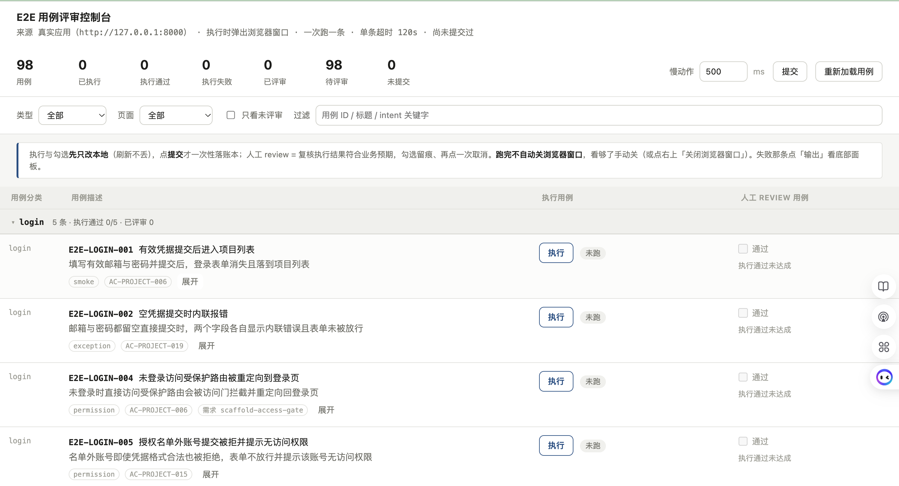

# Atlas — 践行 Project Harness 的全流程 AI 编程工作流

<p align="left">
  
  
  
  <a href="https://sunwenzhe-git.github.io/atlas/"></a>
</p>

> 📖 **官方文档与官网**：[https://sunwenzhe-git.github.io/atlas/](https://sunwenzhe-git.github.io/atlas/)

> **Coding Agent 有 Agent Harness，而项目全生命周期更需要 Project Harness。**  
> 
> **Project Harness（项目级工程线束）是由 Atlas 原创提出的核心概念。**  
> 在现代 AI 编程中，外部 Agent Harness 关注的是工人（模型）在单次任务中如何调用工具与调用经验；但复杂的真实软件工程，更需要在代码库内部建立一套守护全生命周期的工程线束 —— 即 **Project Harness**。  
> Atlas 为你的项目提供这套线束：应然资产先行、机器严格对账、人机协同终验。

---

## 目录

- [一、为什么需要 Project Harness？（破局 Vibe Coding）](#一为什么需要-project-harness破局-vibe-coding)
  - [1. 行业现实：写得越快，烂尾越彻底（NBER 弱环节假说）](#1-行业现实写得越快烂尾越彻底nber-弱环节假说)
  - [2. 经典体系结构 🆚 AI 时代体系结构映射](#2-经典体系结构--ai-时代体系结构映射)
  - [3. 为什么说 Project Harness 是 AI 时代的 Spring Boot？](#3-为什么说-project-harness-是-ai-时代的-spring-boot)
  - [4. 工人手记 🆚 监理蓝图：为什么有了 Agent 记忆仍需 Project Harness？](#4-工人手记--监理蓝图为什么有了-agent-记忆仍需-project-harness)
- [二、核心架构：两层正交治理体系与三环闭环](#二核心架构两层正交治理体系与三环闭环)
  - [1. 两层正交模型（项目级平面 🆚 需求级平面）](#1-两层正交模型项目级平面--需求级平面)
  - [2. 核心武器库：三环资产体系（Rings）](#2-核心武器库三环资产体系rings)
  - [3. 唯一单向编排件（atlas-apply 会话技能）](#3-唯一单向编排件atlas-apply-会话技能)
- [三、快速开始（Quick Start）](#三快速开始quick-start)
  - [1. 依赖准备](#1-依赖准备)
  - [2. 全局安装 CLI 与项目初始化](#2-全局安装-cli-与项目初始化)
  - [3. 核对技术栈画像 (`product/stack-profile.yaml`)](#3-核对技术栈画像-productstack-profileyaml)
  - [4. 怎么快速使用？（大白话为主，确定性入口兜底）](#4-怎么快速使用大白话为主确定性入口兜底)
- [四、创新设计：E2E 用例评审控制台（人机协同终验）](#四创新设计e2e-用例评审控制台人机协同终验)
- [五、技术纵深：代码图谱（Code Graph）优化逆向抽取](#五技术纵深代码图谱code-graph优化逆向抽取)
- [六、变异证明（Mutation Proving）](#六变异证明mutation-proving)
- [七、断言规范：抗伪造、累加链与 testid 薄桩](#七断言规范抗伪造累加链与-testid-薄桩)
- [八、门禁系统（Gates）](#八门禁系统gates)
- [九、自带技能生态（Built-in Skills & Agents）](#九自带技能生态built-in-skills--agents)
- [十、贡献与流水线协同（RFC 机制）](#十贡献与流水线协同rfc-机制)
- [十一、社区交流（钉钉群）](#十一社区交流钉钉群)
- [十二、开源协议（License）](#十二开源协议license)

---

## 一、为什么需要 Project Harness？（破局 Vibe Coding）

在纯粹依赖 Agent 自由发挥的 AI 辅助编程（Vibe Coding）中，开发者普遍会遇到难以逾越的工程瓶颈：

1. **上下文截断导致历史失忆**：长周期会话一旦被总结压缩，模型会遗忘上一轮方案为什么这么选，甚至反复推翻既有架构；
2. **“伪完成”幻觉（False Pass）**：模型宣称“功能已全部实现”，实际上只写了前端表单，未落持久化存储；或者仅凭 Toast 弹窗自证成功；
3. **单源事实坍塌**：接口契约、代码实现、测试用例散落在不同角落，修好 A 坏了 B，代码越写越腐败；
4. **形式主义审查**：让生成代码的同一个 Agent 自己审查代码，审查结果永远是”毫无问题”。

### 1. 行业现实：写得越快，烂尾越彻底（NBER 弱环节假说）

**这不是个别人的体感，而是有数据佐证的行业规律。**  
NBER（美国国家经济研究局）2026 年工作论文 35275 追踪了超过 50 万名 GitHub 开发者：自主编码 Agent 把代码提交量推高了约 240%，项目数只涨约 80%，真正发布出去的软件只涨约 30%。

论文把这种现象命名为**「弱环节假说」**——上游代码写得再快，只要卡在评审、集成、发布这些下游环节，多写的代码就变不成交付。模型只加速了「写」，加速不了「判断」——边界怎么定、改动波及谁、验收怎么算对，这些下游判断环节正是 Atlas 用应然资产与机器门禁接管的部分。

### 2. 经典体系结构 🆚 AI 时代体系结构映射

如果从计算机经典体系结构的演进视角来审视当前的 AI 编程生态，各层分工其实一目了然：

| 经典体系结构 | AI 编码时代映射 | 代表角色 / 组件 | 核心职责与分工 |
| :--- | :--- | :--- | :--- |
| **CPU / 算力核心** | **LLM（大语言模型）** | Claude 3.7 / GPT-5 / GLM-5 | 负责纯粹的逻辑推理与自回归计算（纯算力输入与输出） |
| **操作系统 / Runtime (OS)** | **Agent Harness** | Claude Code / Cursor / Pi Agent / OpenCode | **提供系统调用（Syscall）与运行环境**<br>• 文件读写、Bash 执行（工具调用）<br>• 内存与缓存管理（KV Cache 保温、上下文窗口截断）<br>• 多进程调度（Subagent 派生） |
| **工程框架 / 工业级脚手架** | **Project Harness** | **Atlas** / Trellis / OpenSpec | **定义项目物理秩序与全生命周期防线**<br>• 规范与应然资产基线（PRD / AC 账本）<br>• 依赖图谱影响面基准（可选增强，advisory）<br>• 机器物理阻断门禁（防止 AI 敷衍实现与伪造测试） |

### 3. 为什么说 Project Harness 是 AI 时代的 Spring Boot？

“脚手架”常被理解为 `npm create` 或 `vue-cli` 这种生成一次空目录就退场的工具。但 **Project Harness 不是一次性模板，它是像 Spring Boot 一样的全生命周期工程框架（Framework）**：

1. **从“散装手搓”走向“约定优于配置 (Convention over Configuration)”**：  
   在 Spring Boot 诞生前，Java 开发者各凭喜好手搓 XML、配置 Web 容器，团队项目极其混乱脆弱；现在的 AI 编程亦然，大家都在各自的 `.cursorrules` 和 Prompt 里给 AI 打零散补丁。**Atlas 则如同 Spring Boot，为 AI 编程立下了第一套工业级工程规范**：目录组织标准、单源事实资产、两层正交状态机，开箱即用。
2. **从“人肉盯防”走向“框架级拦截防呆 (Poka-Yoke)”**：  
   Spring Boot 依靠分层架构与拦截器（AOP）规范初级程序员的代码；而面对“极具创造力但极其热衷抄近道（写假测试、改宽断言、自报通过）”的 AI，**Atlas 的硬门禁（Iron Gates）、变异证明与 AST 静态审查充当了物理拦截器**。不满足规范的代码，在退出码层面直接阻断（FAIL=1），从机制上堵死漏洞。
3. **自带开箱即用的工程度量 (Actuator)**：  
   如同 Spring Boot Actuator 提供全套健康检查与审计端点，Atlas 提供了四态门禁报告、代码依赖拓扑与 E2E 慢动作可视化控制台，让整个代码库的真实功能健康度时刻机器可度量。

### 4. 工人手记 🆚 监理蓝图：为什么有了 Agent 记忆仍需 Project Harness？

* **Agent Harness 的记忆是“工人的经验手记（模糊且概率性）”**：  
  现代 Coding Agent 确实拥有记忆机制（如 auto-memory、向量检索或会话手记）。但这种记忆本质上是**自然语言的经验总结与概率召回** —— 它无法提供机器确定性。面对大型系统，模型依旧会遗忘边界、漏掉关联依赖、甚至产生假完成幻觉；
* **Project Harness 维护的是“工程蓝图与机器门禁（确定且可证伪）”**：  
  Atlas 原创提出的 Project Harness 不依赖模型的“记忆自觉”，而是将应然资产（PRD 验收准则、结构事实、E2E 验收用例）直接固化在代码仓库内，并用双向集合对账门给出硬性的 0/1 判定。**工人的个人手记再丰富，也绝不能替代工地的建筑蓝图与机器监理！**

---

## 二、核心架构：两层正交治理体系与三环闭环

在 AI 编程的实际落地中，Atlas 将整套软件工程纪律清晰划分为**两大正交平面**与**三环资产闭环**：

```
┌─────────────────────────────────────────────────────────────┐
│                 Atlas：全生命周期的 Project Harness            │
│                                                             │
│   ┌─────────────────────────────────────────────────────┐   │
│   │   项目级平面（全局资产与秩序）                        │   │
│   │   结构基线 ──► 项目级 PRD (AC) ──► E2E 验收总索引与分片 │   │
│   └──────────────────────────┬──────────────────────────┘   │
│                              │  单向编排：atlas-apply (Skill) │
│                              ▼                              │
│   ┌─────────────────────────────────────────────────────┐   │
│   │   需求级平面（小需求任务执行，由内置的 Trellis 承担）    │   │
│   │   需求卡 (Task) ──► 业务代码编写 ──► 任务归档        │   │
│   └─────────────────────────────────────────────────────┘   │
└──────────────────────────────┬──────────────────────────────┘
                               │ 通过路径薄桩与钩子注入给外部 Agent
                               ▼
┌─────────────────────────────────────────────────────────────┐
│   外部 Coding Agent（如 Claude Code / Cursor / Codex 等）    │
│   提供 Agent Harness（模型上下文、工具调用、单次会话）         │
└─────────────────────────────────────────────────────────────┘
```

### 1. 两层正交模型（项目级平面 🆚 需求级平面）
1. **项目级（应然资产层）**：定义“这个系统是什么、长什么样、怎么算做对”。包含**结构事实**（适配器 AST / 正则逆向抽取；图谱为可选文件枚举增强）、**项目级 PRD**（业务规则单源）、**E2E 验收用例**（真实靶场可证伪用例），以及跨需求生效的**架构决策记录**（`product/adr/NNNN-<slug>.md`）。
2. **需求级（小需求执行层）**：定义“这次改动改什么、怎么写代码”。由内置的 **Trellis** 任务系统承担，Atlas 本身**不侵入业务代码实现**。
3. **`apply` 单向衔接**：需求在进入实现前，先由 Agent 唤起 `atlas-apply <需求ID>` 技能将需求增量合并入项目级应然资产，坚决杜绝“先写代码、事后补文档”的失控循环。

### 2. 核心武器库：三环资产体系（Rings）

Atlas 的核心由 **三环（Rings）** 构筑成不可逾越的应然防线：

| 构件 | 角色 | 产物位置 | 核心机制 |
|---|---|---|---|
| **Ring 1: 结构基线** (`atlas-structure`) | **实然事实** | `.trellis/spec/structure/` | 适配器（AST / 正则）逆向提取代码事实（路由、数据模型、API、测试现状）。事实区由机器刷新，语义区由规范治理，双份维护（`current` / `legacy`）。 |
| **Ring 2: 项目级 PRD** (`atlas-prd`) | **业务应然** | `product/prd/` | 业务叙事单一真相源（SSOT）。双向强制追踪链：`功能 ──► 业务规则 ──► 验收准则(AC) ──► E2E 用例`。不挂实现状态，保持应然纯粹性。 |
| **Ring 3: 验收用例** (`atlas-e2e`) | **验证应然** | `product/e2e/` | 真实应用单段执行（Playwright）。总索引唯一入口，一例一片（页面分片），以 `data-testid` 为唯一硬锚，严禁将瞬时反馈（Toast）当终态。 |

### 3. 唯一单向编排件（atlas-apply 会话技能）

> 💡 **提示**：`apply` 是由 Agent 在会话中执行的认知编排技能（Skill），通过 `/atlas-apply <模式>` 或大白话唤起，终端无独立的 `atlas apply` 命令：
* `atlas-apply <需求ID>`：**需求增量模式**。识别受影响的 PRD 与 E2E 页面分片，增量生成用例资产并跑门禁；
* `atlas-apply adopt`：**存量项目开户模式**。面向既有代码库，先逆向抽取结构基线，PRD 开到“开户最小集”，不预设虚拟 E2E，由后续需求逐步长出；
* `atlas-apply all`：**绿地从零立项模式**。按序全量串行初始化 `structure → prd → e2e`，幂等、断点续跑；
* `atlas-apply backfill`：**反向回流模式**。把实现期发现的上游缺口裁决条目攒批（≤10 条/批）灌回 PRD 用例并重跑门禁。

---

## 三、快速开始（Quick Start）

### 1. 依赖准备
* **Node.js 18+**（CLI 运行环境）
* **Python 3.10+**（核心校验器与生成引擎）
* **Playwright**（E2E 测试运行器：Node 版，由项目 node_modules 提供）
* **[Trellis](https://github.com/mindfold-ai/trellis)**（必需宿主执行器，负责需求级任务调度；安装：`npm install -g @mindfoldhq/trellis`）
* *(可选)* **CodeGraphContext (cgc)**：**仅后端 / 全栈项目建议安装**（纯前端栈实测近乎零收益，atlas 在确认画像时按栈门控提议、不会向纯前端项目推销）——安装：`uv tool install codegraphcontext`（或 `pip install codegraphcontext`）

### 2. 全局安装 CLI 与项目初始化

```bash
# 全局安装 Atlas CLI
npm install -g atlas-project-harness

# 进入你的项目目录
cd your-project

# 一键初始化并装配 Atlas 工作流（自动探测平台、下发 Skills 与契约）
atlas init
```

装配命令将自动完成：
1. 将核心契约、校验器、模板整包镜像至目标项目 `.atlas/`；
2. 为你的 Agent 平台生成专用 Skills 瘦桩（`atlas-structure`, `atlas-prd`, `atlas-e2e`, `atlas-apply`, `atlas-grill`, `atlas-design-review`, `frontend-design` 等）；
3. 向 `.trellis/` 注入工作流补丁组（Plan 1.6 应然资产挂载、各阶段技能路由、根因分析优先红用例）与项目接线（`AGENTS.md` 指针、`.trellis/config.yaml` 的 `after_finish` hook，pi 宿主另登记 `.pi/` 下的 `/atlas` 控制台扩展）；
4. 部署只读审查专用 Agent：`atlas-reviewer`。
5. *（pi 宿主专有）* 落地 `/atlas` 控制台扩展——`/atlas status` 会报**开户态**（「装配 ≠ 开户」），未开户时直接告诉你去跑 `adopt`。非 pi 项目不创建 `.pi/`。

> 🔄 **升级与更新**：
> - **全局 CLI 自身升级**：运行 `atlas upgrade`（自动通过 npm 拉取最新全局包，支持 `--tag beta` 或 `--dry-run`）。
> - **项目内工程线束刷新**：在项目目录下运行 `atlas update`（安全刷新 `.atlas/` 资产与平台 Skills 瘦桩，版本戳对账更新，业务配置严格保护不覆盖）。

### 3. 核对技术栈画像 (`product/stack-profile.yaml`)
这份草稿**不用你手改**：首跑开户时 Agent 会带着你逐项核对（`origin` / `apps` / `role` / `adapters`）后落盘。出厂草稿含占位符，未替换真实字段前 `atlas check` 必有门禁 FAIL —— 这是 fail-closed 的预期行为，不是装坏了：
```yaml
product: MyAwesomeApp
origin: greenfield          # greenfield: 全新项目 | adopt: 存量老项目接入

apps:
  - name: web
    path: frontend
    kind: frontend          # frontend | backend | fullstack | mobile
    role: landing           # landing: 当前落地实现 | legacy: 事实来源（重构/存量项目才有）
    stack: React + Vite     # 自由文本，仅作展示，atlas 不据此做任何判断
  - name: api
    path: backend
    kind: backend
    role: landing
    stack: FastAPI

adapters:                   # null = 该类事实降级为 agent 撰写
  routes: null              # 路由 / 页面清单
  api: null                 # 接口清单
  models: null              # 数据模型清单
  tests: null               # 测试现状

e2e:
  runner: node-playwright
  node_modules: frontend/node_modules   # node 运行器的依赖目录（相对项目根）
  app_base_url: http://127.0.0.1:8000
  review: null              # null = 默认使用会话模型；可配置备用模型做交叉审查

graph:                      # 可选：声明后 routes 走图谱枚举、apply 先跑影响面推导
  backend: cgc
```

> `apps[]` 的 `name` / `path` / `kind` / `role` 四项为**必填**（缺一即被 `validate_stack_profile` 判 FAIL），`origin` 只有 `greenfield` / `adopt` 两个取值。

### 4. 怎么快速使用？（大白话为主，确定性入口兜底）

Atlas 完全做到了**“日常全自动，低频全靠大白话”**：

#### 场景 A：存量老项目首次接入（最常用）
唤起技能（确定性入口）：
```text
/atlas-apply adopt
```
也可以只说一句大白话，让 Agent 自己选模式：
```text
“帮我把这个项目接入 Atlas 工作流”
```
无论哪种入口，Agent 都会逆向扫描现有代码拓扑，建立应然资产起点（不瞎猜老业务用例，只登记基线），并在开户前与你核对画像草稿、把占位符换成真实路径。

> ⚠️ **装配 ≠ 开户**：`atlas init` 只装配线束（`.atlas/`、`product/` 骨架、AGENTS.md 指针）。**开户产物是 `product/prd/` 与 `.trellis/spec/structure/` 的内容**——两者为空就是尚未开户。所以「已经装过 atlas」不代表已接入：此时若 Agent 回你「已接入」或反问你「是不是接过了」，直接敲 `/atlas-apply adopt` 即可（开户按产物存在与否断点续跑）。

> 完整流程、为什么存量页面不会把门禁刷红、后端项目的补充配置，见 [存量项目接入指南 (adopt)](https://sunwenzhe-git.github.io/atlas/guide/legacy-adoption)。

#### 场景 B：全新空白项目立项
唤起技能：
```text
/atlas-apply all
```
或对 Agent 说：
```text
“跑一下三环全量构建，建立应然基线”
```
Agent 全量串行初始化 `structure → prd → e2e`。

#### 场景 C：日常迭代提需求（100% 自动无感）
你**无需敲任何 Atlas 命令**，像往常一样在 Trellis 中创建任务（如 `/trellis:start 优化配音列表`）：
* 工作流在 Phase 1.6 **自动调度 Agent 执行** `atlas-apply <需求ID>` 技能完成应然资产编译；
* 需求写完收口时，自动触发钩子刷新最新代码事实。

#### 场景 D：一键体检与门禁自检
随时可在终端跑一条命令检查全项目应然资产与门禁状态（`--fast` 为秒级轻量体检，仅跑静态校验器与生成物新鲜度；默认模式还会跑出厂测试与浏览器真跑）：
```bash
atlas check --fast
```

---

## 四、创新设计：E2E 用例评审控制台（人机协同终验）

除了凭借精准的影响面裁剪带来**更快的执行速度与更省的 Token 开销**之外，Atlas 最具价值的突破在于：**它真正增进了人对项目全局的理解，让人重新掌握系统的主导权。**

Atlas 随包自带了一个**纯 Python 标准库编写的本地轻量级可视化服务 —— E2E 用例评审控制台**：

```bash
启动命令：atlas console    # （或直接执行 python3 .atlas/scripts/e2e_console.py）
访问地址：http://127.0.0.1:4190
```

<p align="center">
  
</p>

### 核心人机协同心智：从“机械连点工”到“产品体验导演”

1. **不仅更快、更省 Token，而且更懂项目**：
   * 很多纯黑盒方案虽然追求执行指标，但往往导致代码越写越多，人却越来越看不懂系统长什么样；
   * Atlas 在保持极致的增量速度与 Token 节省的同时，通过 **PRD 层的结构化验收准则（AC）** 与 **E2E 层的真实用例分片**，把系统逻辑重构为人类一眼就能看懂的业务地图与交互旅程。人对代码始终拥有绝对的理解与把控力。
2. **替代人手点一遍，把精力留给“体感”**：
   * 需求实现后，过去需要开发者人肉去机械地重复点 20 次按钮、填 20 次表单，点到最后往往大脑疲劳；
   * 控制台的本质是：**让脚本替代你的人手去做枯燥的机械操作，但在你的眼皮底下慢动作（`500ms Slow-Mo`）完整弹窗回放**。
3. **当场捕获交互别扭感（别不别扭，看着它点当场立改）**：
   * 当你的双手从机械连点中被解放出来后，大脑的全部带宽都能用于审视真实体感：
     * *“这个弹窗关闭的节奏是不是太生硬了？”*
     * *“页面跳转后那个卡片为什么会有轻微的布局跳动？”*
     * *“这个错误提示文案给得是不是太反人类？”*
   * 一条用例慢速跑完，交互顺不顺畅、别不别扭**当场就能看到，当场就能让 Agent 顺手改掉**！
4. **冒烟先行（Smoke First）：几分钟看清产品骨架是否合理**：
   * 实战推荐节奏：新功能实现后，在控制台**先过滤并快速过一遍 smoke（冒烟用例）**；
   * 仅仅花两三分钟，就能立刻感知整个核心流程顺不顺、产品交互大局到底合不合理。核心旅程确认对味后，再深入去跑边界异常用例。
5. **人类确认通过，后续永久沉淀为黑盒无头回归**：
   * 只要当前用例交互顺畅、业务预期达标，人类在控制台打勾并通过；
   * 点击全局「提交」落盘到评审账本后，这条用例就沉淀为永久资产。在日后的日常 CI、提交门禁或迭代中，它就可以放心地交给机器在后台以**纯黑盒方式高速回归**，再也不需要人肉重复点一遍！

### 控制台底层机制与严肃门禁：
1. **真实应用有头执行（Headed Slow-Mo）**：
   * 点击单条用例的「执行」按钮，立刻弹起真实浏览器窗口，逐步慢速点击、输入、交互。人类肉眼看清按钮跳动、样式对齐与跳转逻辑。
2. **“执行通过”才解锁“人工 Review”（状态机锁）**：
   * 只有当 Playwright 脚本在真实应用中跑出绿色通过态，右侧的「人工 Review 通过」复选框才会真正解锁；
   * 杜绝脚本红灯但人类盲目打勾，也杜绝脚本绿灯但界面视觉崩塌的伪通过。
3. **单并发隔离与故障现场保留**：
   * 同时严禁并发执行两条，防止数据相互污染；
   * 跑完后**不自动关闭浏览器窗口**，留足时间给人类检查 DOM 现场；单条失败时，底面板直接输出断言报错日志。
4. **单写者架构与提交落盘（Append-Only Ledger）**：
   * 页面上的每一次执行和打勾先且仅保存在浏览器本地（`localStorage`，刷新不丢）；
   * 只有人类审视完毕、点击全局**「提交」**按钮时，才**一次性原子写入**：
     * 向 `product/e2e/reviews/console/events.jsonl` 追加一条不可篡改的事件快照；
     * 派生人读的 `ledger.md` 评审账本；
     * 原子回写总索引 `product/e2e/e2e-index.md` 的状态列。

---

## 五、技术纵深：代码图谱（Code Graph）优化逆向抽取

传统基于纯 AST 或静态正则的代码分析看得见单文件语法树，跨文件的函数调用关系却要靠人肉逐文件倒查。图谱把「改一个函数，哪些函数调它」变成可查询的一跳——**能力边界同样先讲清楚**：ORM / 属性访问、反射与框架入口、**以及 JSX 组件的渲染引用**都不在静态调用图内（实测 cgc 0.6.13：`<Comp />` 形态不产生任何调用边 ⇒ 纯前端栈上图谱近乎买不到东西，atlas 按栈门控、纯前端项目不提议启用）。

Atlas 引入了**图谱后端隔离层（`adapters/_graph.py`）**，接入基于 **CodeGraphContext (cgc / FalkorDB 知识图谱后端)** 的图查询能力。**当前消费面只有两处**——先把边界说清楚，免得你为一个用不上的能力装依赖：

```
  Git 仓库代码 (FastAPI/React/...)
               │
               ▼  cgc 建索引（用前现刷，见下）
  ┌──────────────────────────────────────────────┐
  │         全仓代码知识图谱 (Code Graph)          │
  │  File ──► Class ──► Function ──► Caller/Callee │
  └──────────────────────┬───────────────────────┘
                         │
        ┌────────────────┴────────────────┐
        ▼                                 ▼
  routes 适配器的**文件枚举通道**       影响面基准 (impact_report)
  • 只换「哪些文件参与识别」            • 需求前置推导受影响符号与调用方
  • 解析逻辑与正则通道**同一份**        • 与 git diff 对账（advisory 基准）
```

> **它不做什么**（同样重要）：图谱**不**做业务域聚类——域由 structure 环按路由簇 / 目录簇 / 模型命名簇 / 接口前缀簇多信号投票得出（`rings/structure/reference.md` §2.1）；图谱也**不**替代任何一个适配器的解析层，枚举出来的文件照样要过同一套解析逻辑。段未声明或后端未安装 ⇒ 全部显式降级（适配器 `WARN` + 回退正则、报告器 `not_ready`），不影响其余流程。

### 图优化的 4 大工程设计：
1. **薄后端、厚自有**：
   * 图谱引擎只当“哑索引与高速查询接口”；所有智能影响面分层等算法全部由 Atlas 自有 Python 脚本实现，域归类走多信号投票（不发图谱，见上「它不做什么」）。后端无论换成 FalkorDB、Neo4j 还是内存图，核心业务逻辑稳如泰山。
2. **用前现刷，拒绝陈旧（Freshness Guarantee）**：
   * 图谱没有后台常驻的定时任务。每个脚本在查询图谱前自动调用 `ensure_index()`，比对当前 `git HEAD + 脏文件集` 的哈希摘要；哈希不一致则秒级重构索引，**过期状态在消费时构造性不存在**。
3. **确定性查询（Deterministic Ordering）**：
   * 图谱层的所有 Cypher/SQL 查询强制追加 `ORDER BY`，保证在同一代码状态下跑出的图谱关系绝对确定，确保上层资产可 diff、可对账。
4. **优雅降级，Fail-Open 保护**：
   * 若外部未安装图谱后端，隔离层自动探测并降级为纯 AST/正则模式，并以显式 `WARN` 告警，绝不破坏基础构建流程。

---

## 六、变异证明（Mutation Proving）

很多 CI 门禁最大的隐患是：**代码写错了，校验器永远返回 PASS，人以为自己有防线，实际上形同虚设。**

Atlas 坚持**变异证明（Mutation Proving / M 系列钉子测试）**原则：
* **门禁自身必须证明会报红**：编写任何一条新校验规则，必须同步提交故意注入破坏性脏数据的“变异测试用例”（M 系列钉子，编号已到 M93——编号在各自测试文件内自成序列，同一号在不同门含义不同）；
* **自洽门与双向红灯验证**：
  * 变异测试人工制造各种边界事故：字段缺失、双向差集、静默截断、假冒通过、未声明退役；
  * 只有在变异数据下门禁**百分之百报红**，这条规则才被允许合入出厂检验套件（`python3 -m pytest tests/`）；
  * 杜绝任何“永远绿灯的摆设门禁”。

---

## 七、断言规范：抗伪造、累加链与 testid 薄桩

在生成与执行自动化测试方面，Atlas 建立了一整套经实战检验的严格规范：

### 1. 结果断言硬口径（抗瞬时反馈与跨真相源断言）
* **禁止拿瞬时反馈自证成功**：Toast 提示弹窗消失、弹窗关闭、按钮加载状态恢复，**一律不得算作断言通过**（前端可能只写了个假定时器）；
* **写操作必须刷新后复断言**：新建、编辑、删除动作完成后，测试脚本必须**强制重新刷新页面**，从服务端拉取真实持久化数据再次校验；
* **跨真相源断言**：断言必须落在与被操作控件**不同的视图**（如在表单点保存，必须到全局列表或只读详情页断言值变化），防止局部内存假更新。

### 2. 累加链测试与播种解耦（`declare` vs `enforce`）
* **累加链难题**：在长业务流中（创建草稿 ──► 录音 ──► 调优 ──► 导出），传统 E2E 每次重置数据库会瞬间炸毁前序步骤的状态；
* **双模播种解耦**（`seed.mode`）：
  * `enforce`（常规独立模式）：每条用例运行期执行数据库种子重置；
  * `declare`（累加链专属模式）：种子声明仅参与静态数据模型对账（确保字段存在），**不在运行期发射破坏性重置**，完美支持带 Delta 差量断言的链式业务测试。

### 3. `testid` 薄桩机制（Thin Stubs Injection）
* **解决跨目录认知成本**：写前端代码的 Agent 经常因不知道有哪些 `data-testid` 而乱起名字；
* **自动注入上下文**：Atlas 从用例分片中自动提取该页面的全部应然 `testid`，编译为小巧的 `.trellis/spec/conventions/testid.md` 薄桩文件，通过 Trellis 原生机制直接注入到 Agent 的写代码上下文中，实现两端零心智对齐。

---

## 八、门禁系统（Gates）

在 Atlas 中，“代码写完了”不取决于 Agent 的自述，而取决于**机器对账门禁（Hard Gates）**：

```
                ┌──────────────────────────────────┐
                │ 走查单确认门 (人侧: UI 旅程拍板)   │
                └─────────────────┬────────────────┘
                                  ▼
                ┌──────────────────────────────────┐
                │ 环间独立审查门 (机器: 拦截 Critical)│
                └─────────────────┬────────────────┘
                                  ▼
   [实现阶段] ──► ┌──────────────────────────────────┐
                │ 实例 ⑤ 实现审查门 (只读进程 diff 审查)│
                └─────────────────┬────────────────┘
                                  ▼
                ┌──────────────────────────────────┐
                │ 双向对账门 (testid 实然 ⇔ 应然集合) │
                └─────────────────┬────────────────┘
                                  ▼
                ┌──────────────────────────────────┐
                │ impact 对账门 (预测影响面 ⇔ git diff)│
                └─────────────────┬────────────────┘
                                  ▼
                             [收口归档]
```

> 💡 **核心对账门禁（代表性节选）**：机器侧全量总账见 `.atlas/shared/gates.md`；运行 `atlas check` 时会聚合执行全部登记校验器。

1. **`testid` 双向集合对账门 (`validate_testids.py`)**：
   * **断言**：用例分片中声明的应然 `testid:` 清单，与前端源码中真实扫描出的 `data-testid` **按页面双向集合严格相等**。漏写控件报 FAIL，多写无用埋点报 FAIL。
2. **实例 ⑤：实现代码 ⇔ 应然资产独立审查（防漏审；机制与对账门已定形，外部执行器接入中，见 shared/gates.md）**：
   * 需求实现后、归档收口前，由独立进程执行只读 diff 审查（Fresh Context 隔离；契约与转换器见 scripts/cli_review_convert.py）；
   * **应审 N / 实审 M 严格对账**：实测表明大模型审查大体积 diff 时会悄悄跳过文件；若实际评审文件数 `M < N`，无论结论如何一律报红拒绝，发现 `Critical` 缺陷一票否决。
3. **后端/全栈测试用例 ⇔ AC 跨语言对账门 (`validate_ac_alignment.py`)**：
   * 校验后端与全栈测试用例中挂载的验收标记（如 `@pytest.mark.ac("AC-xxx")`）与 PRD 声明的 AC 集合严格对齐，防止实现测试漏测或假挂载。
4. **impact 预测对账门 (`impact_reconcile.py`)**：
   * 在需求规划时预测的影响面集合，与收口时的真实 `git diff` 变更文件列表自动比对差集，持续校准模型的架构感知力。
5. **设计档案豁免 ⇔ 检测器双向对账 (`validate_design_exemptions.py`)**：
   * 设计档案中的豁免理由必须与代码扫描器中的忽略规则双向集合相等，关掉报警必须有台账，杜绝无台账的私自豁免。
6. **装配版本完整性门 (`.atlas/VERSION`)**：
   * 目标项目中的装配态与 Atlas 源包内容哈希实时对账，源码更新未重新同步时明确报警。
7. **架构决策记录对账门 (`validate_adr.py`)**：
   * 项目级长效架构决策唯一落 `product/adr/NNNN-<slug>.md`；校验编号唯一、状态枚举合法、演进链闭环（`superseded` 必指有效后继）、核心章节（Context / Decision / Consequences）完整，杜绝决策散落多处或私自改写。

---

## 九、自带技能生态（Built-in Skills & Agents）

Atlas 随包完整分发了一套自洽的高阶开发与评审套件：

### 1. `atlas-apply` — 唯一跨环编排件
* 会话内把一条需求编译进项目级应然资产，四种模式：`<需求ID>` 需求增量 / `adopt` 存量开户 / `all` 三环全量 / `backfill` 反向回流；
* 先过三问门（改动既有能力 / 要人确认 UI / 要可重复验收）；三问全否是合法旁路——只走 structure + Trellis，不硬造空 E2E 用例。

### 2. 三环资产技能 — `atlas-structure` / `atlas-prd` / `atlas-e2e`
* **`atlas-structure`（结构基线 · 实然）**：读代码逆向目录与模块地图、路由与接口清单、数据模型，落 `.trellis/spec/structure/`；
* **`atlas-prd`（业务应然单源）**：全局 + 域级 PRD，含可追溯 AC；
* **`atlas-e2e`（验收应然）**：页面分片 + 总索引用例资产，`data-testid` 应然⇔实然按页双向集合校验。

### 3. `atlas-grill` → `atlas-design-review` — 决策压测与独立复核
* **防选择疲劳**：告别动辄抛出 5 个常识选择题导致用户麻木点击“全选推荐”；
* **单轮严控 1~2 问**：只问真正不可逆、存在尖锐 Trade-off 的关键卡点；
* **代价直陈**：模型给出深思熟虑的主选方案，同时**列出该方案的代价与后续不利影响（Trade-off）**，要求用户明确回答是否接受；
* **代码矛盾核验**：方案与既有代码事实矛盾时直接指出，要求裁决是否推翻既有架构；
* 拍板后由 `atlas-design-review` 独立复核（`atlas-reviewer` 为专用只读 Agent，工具集不含写文件与 bash 权限，fresh context 进程隔离），确保无未登记的隐式假设。

### 4. `frontend-design` — 前端品味总监与合规基线
* **两层合一**：第一层提供设计语言与审美旋钮（variance / motion / density）；第二层提供严格的 Web 合规基线（53 份细则文件覆盖 WCAG 可访问性、对比度、Core Web Vitals、暗色模式）；
* 交付前由预检闸门强制走查，纯后端项目自动降级忽略。

> **随包契约（非技能）——产物落笔纪律（零反刍与读者中立）**：所有需求文档、代码注释、Git 提交与 PR 说明按“读者从未看过会话工作过程”书写；会话中被否决的备选方案与反复纠正的过程属于会话控制数据，严禁反刍进交付产物的正文与命名中（契约本体：`.atlas/shared/global-rules.md` §14）。

---

## 十、贡献与流水线协同（RFC 机制）

> **“凡改流水线，必留取证、必记决策、必带测试。”**

当你在真实业务项目中遇到与 Atlas 自身流水线设计相关的问题（门禁误报、契约盲区、规则不合理、新特性诉求）时，请遵循**三位一体 PR 协同机制**：

```
  1. 发现流水线缺陷与客观报错
          │
          ▼
  2. 基于模板记录问题取证与决策权衡
     cp proposals/TEMPLATE.md proposals/RFC-YYYYMMDD-01-主题.md
          │
          ▼
  3. 修改代码并追加测试钉子 (tests/)
          │
          ▼
  4. 发起 PR ──► 维护者一眼看清前因后果，一键审查合并！
```

### 为什么必须三位一体？
* **带取证 (Evidence)**：拒绝无日志、无复现步骤的模糊抱怨，必须附带最小复现代码或终端输出；
* **带决策 (Decision)**：明确写出为什么选择当前解法，以及否决了哪些备选方案（为什么不能简单把报错降级为跳过）；
* **带测试 (Tests)**：任何新规则或 Bug 修复，必须在 `tests/` 补充用例或 M 系列变异证明，保证全量出厂测试（`pytest tests/`）全绿。

详情见 [proposals/README.md](proposals/README.md) 与 [proposals/TEMPLATE.md](proposals/TEMPLATE.md)。

---

## 十一、社区交流（钉钉群）

欢迎加入 **Atlas 官方钉钉交流群**！无论是探讨 AI 编程、Project Harness 架构理念，还是交流工作流落地经验、反馈业务碰撞场景，都欢迎扫码或点击链接入群畅聊：

<p align="center">
  <a href="https://qr.dingtalk.com/action/joingroup?code=v1,k1,wnhPdhM5jGAW/bvbixua4P0eUPQGBoodsrdcpLeOEG1uRVJIwrSsXmL8oFqU5ajJ&_dt_no_comment=1&origin=1" target="_blank">
    
  </a>
  <br />
  <sub>📱 钉钉扫码或 <a href="https://qr.dingtalk.com/action/joingroup?code=v1,k1,wnhPdhM5jGAW/bvbixua4P0eUPQGBoodsrdcpLeOEG1uRVJIwrSsXmL8oFqU5ajJ&_dt_no_comment=1&origin=1" target="_blank">点击此处直接加入群聊</a>（二维码永久有效）</sub>
</p>

---

## 十二、开源协议（License）

本项目基于 **[Apache License, Version 2.0](LICENSE)** 协议开源。

---

<p align="center">
  <b>Atlas</b> — 让 AI 编程拥有真正的工程确定性。<br>
  Built with rigor. Governed by machines.
</p>
